# Customization examples

Paste an example into a new Obsidian note, render it, then right-click a node or the chart and choose Customize. Start with Mindmap, Radar, Pie and Flowchart. The remaining examples cover the rest of the audited types.

## Mindmap

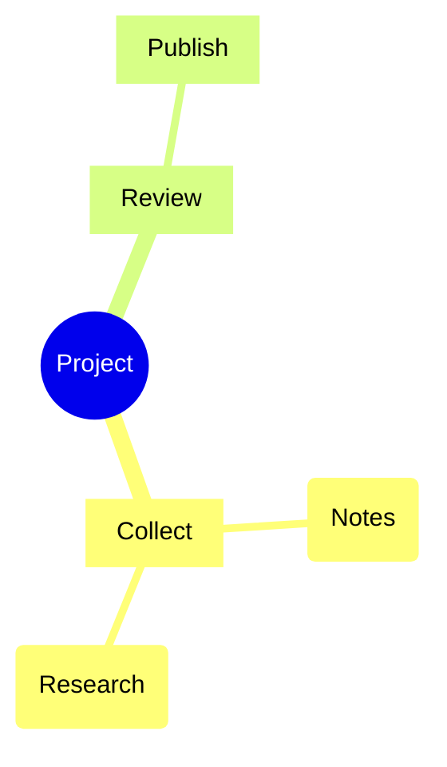

## Radar

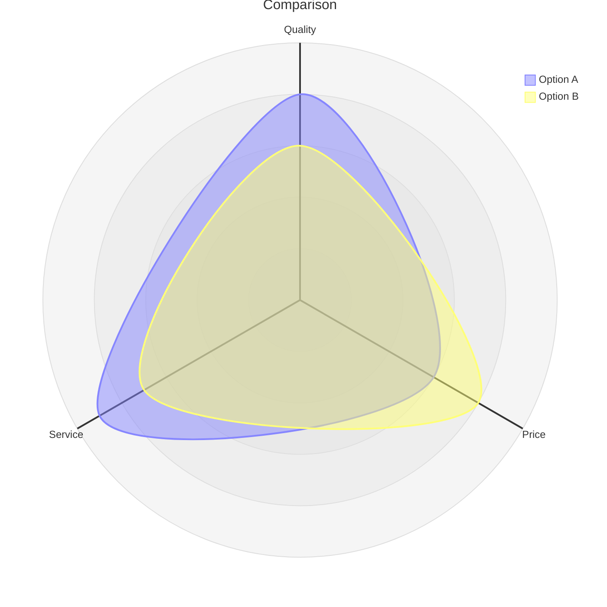

## Pie

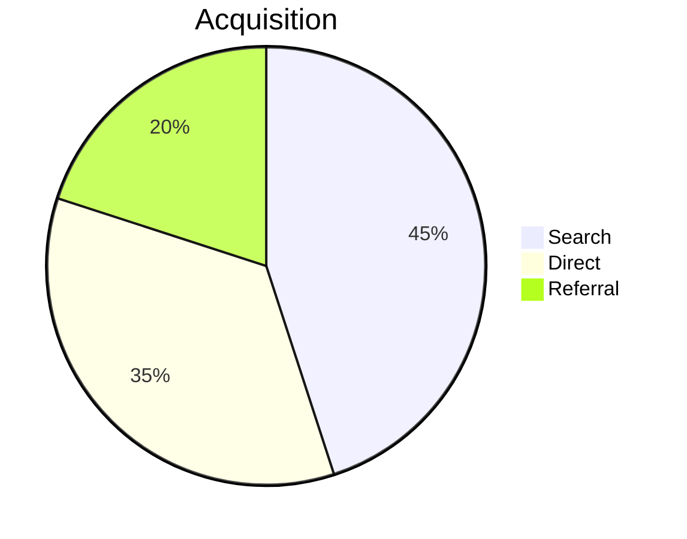

## Flowchart

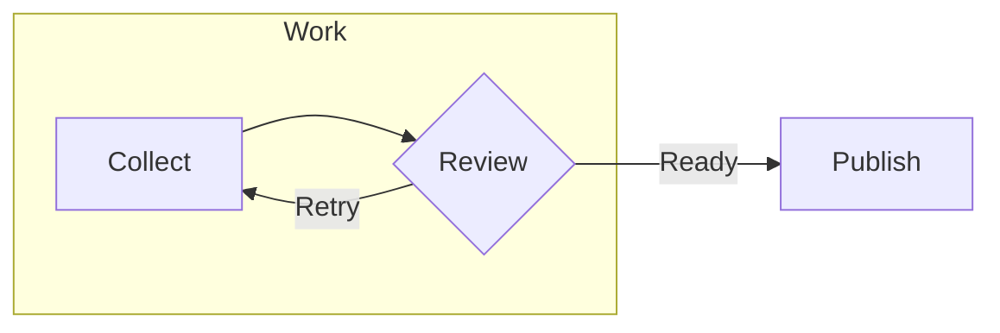

## Agentflow

Right-click a node → Customize → Node shape. Try all six native shapes; each should change the actual geometry.

```mermaid
agentflow-beta TB
  a[Collect] --> b[Review]
  b --> c[Publish]
```

## Architecture

Right-click a service or the API group header → Customize → Service icon / Group icon. Try Cloud, Database, Disk, Internet, Server and No icon. Use original icon restores the initial icon.

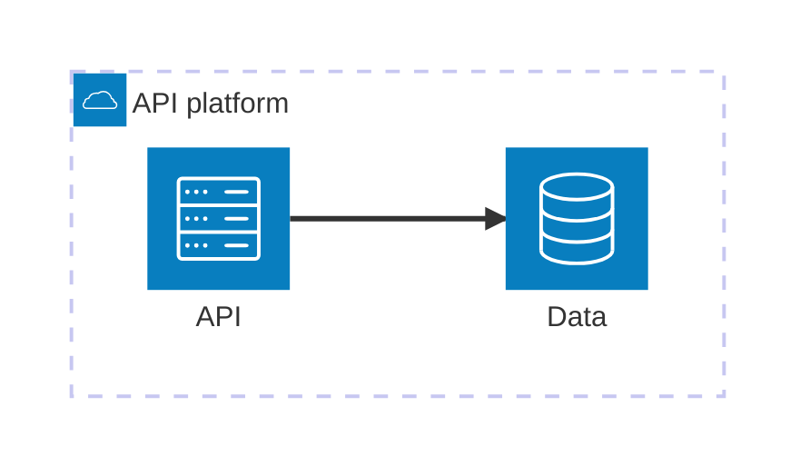

## Block

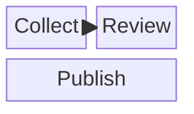

## C4

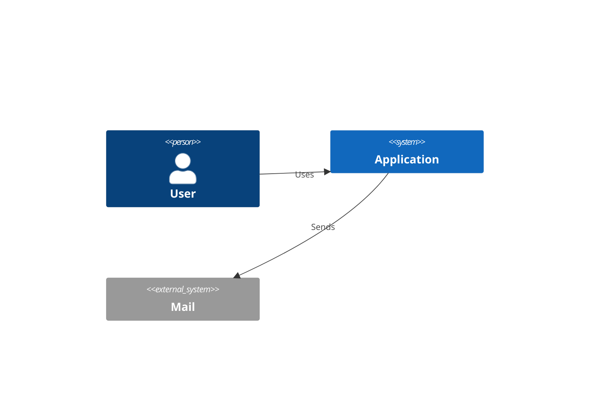

## Class

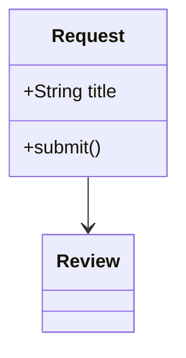

## Cynefin

```mermaid
cynefin-beta
  title Decisions
  complex
  complicated
  clear
  chaotic
```

## Entity relationship

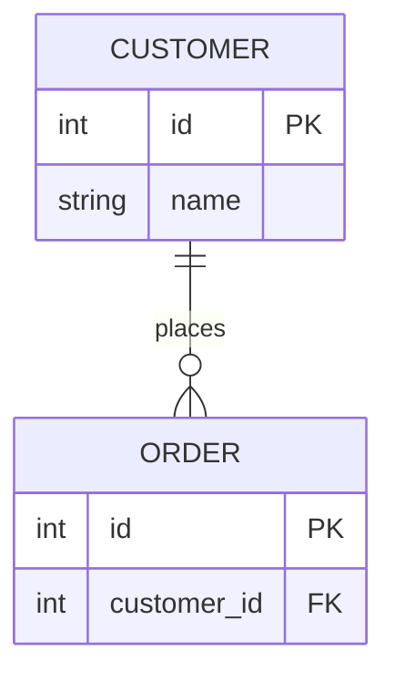

## Event Modeling

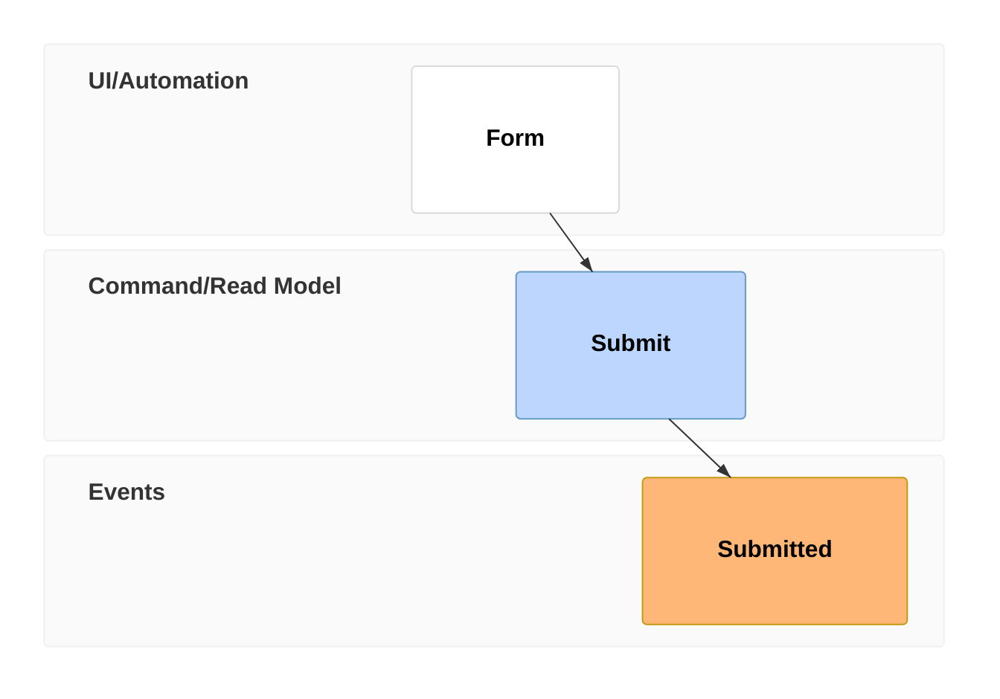

## Gantt

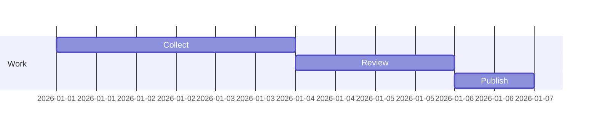

## Git Graph

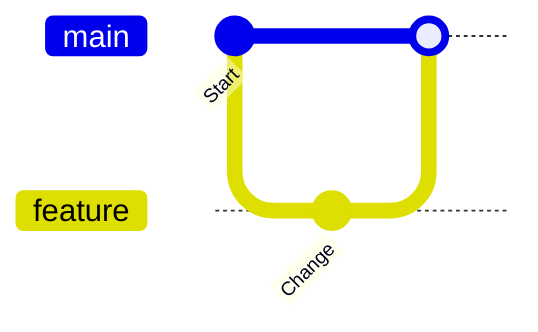

## Ishikawa

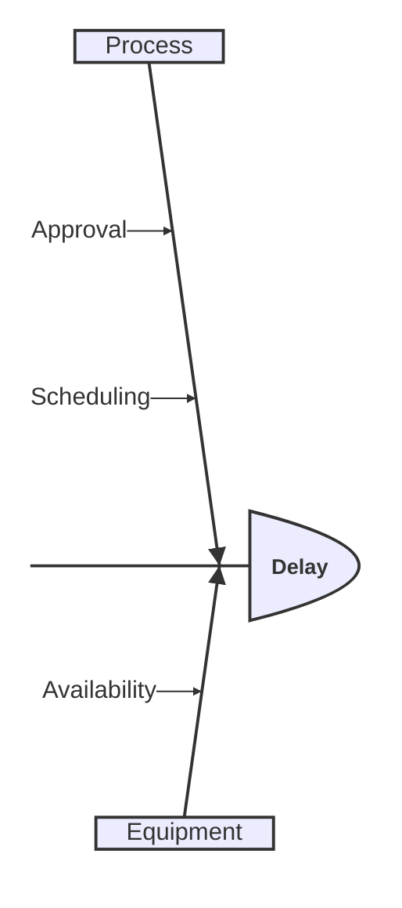

## User Journey

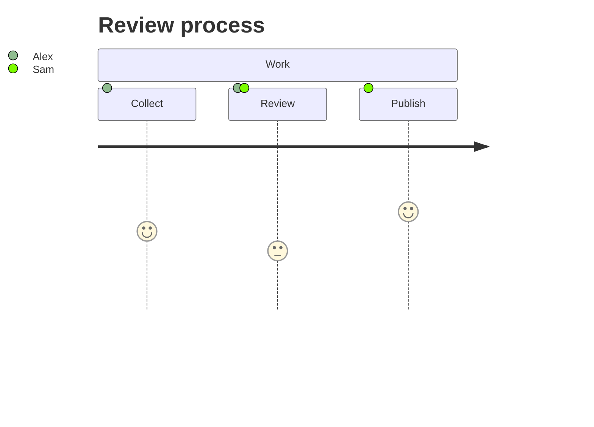

## Kanban

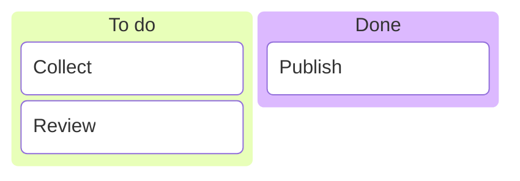

## Packet

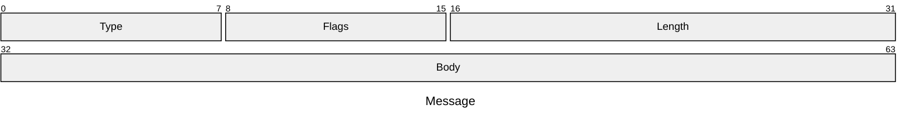

## Quadrant

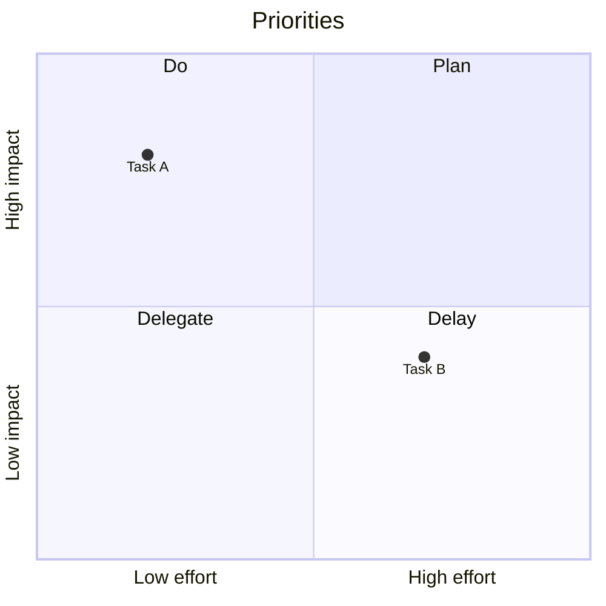

## Railroad

```mermaid
railroad-ebnf-beta
  request = method, path ;
  method = "GET" | "POST" ;
```

## Requirement

```mermaid
requirementDiagram
  requirement fast {
    id: 1
    text: Quick response
    risk: low
    verifymethod: test
  }
  element api {
    type: service
  }
  api - satisfies -> fast
```

## Sankey

```mermaid
sankey
  Search,Visits,45
  Direct,Visits,35
  Referral,Visits,20
  Visits,Sales,30
  Visits,Exit,70
```

## Sequence

```mermaid
sequenceDiagram
  participant User
  participant API
  participant Unused
  User->>API: Request
  Note right of API: Review
  API-->>User: Response
  API->>API: Log
```

## State

```mermaid
stateDiagram-v2
  [*] --> Draft
  Draft --> Review
  Review --> Published
  Published --> [*]
```

## Swimlane

```mermaid
swimlane-beta
  subgraph Sales
    a[Collect] --> b[Review]
  end
  subgraph Delivery
    c[Publish]
  end
  b --> c
```

## Timeline

Right-click → Customize → Diagram settings → Layout → Direction → Top to bottom, then switch to Left to right.

```mermaid
timeline
  title Delivery
  section Plan
    Week 1 : Collect : Review
  section Ship
    Week 2 : Publish
```

## Treemap

```mermaid
treemap-beta
  "Acquisition"
    "Search": 45
    "Direct": 35
  "Other"
    "Referral": 20
```

## Tree View

```mermaid
treeView-beta
  "Project"
    "Research"
      "Notes.md"
    "Review.md"
```

## Use Case

```mermaid
usecase-beta
  actor User
  Review
  Publish
  User --> Review
  Review --> Publish
```

## Venn

```mermaid
venn-beta
  set A["Research"]
  set B["Delivery"]
  union A,B["Both"]
```

## Wardley

```mermaid
wardley-beta
  title Service map
  anchor User [0.9, 0.1]
  component API [0.6, 0.4]
  User -> API
```

## XY chart

```mermaid
xychart
  title "Quarterly sales"
  x-axis [Q1, Q2, Q3, Q4]
  y-axis "Sales" 0 --> 100
  bar [25, 45, 65, 80]
  line [30, 50, 60, 90]
```

